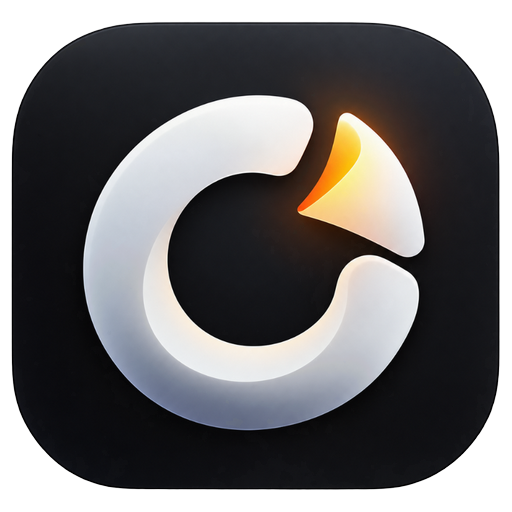
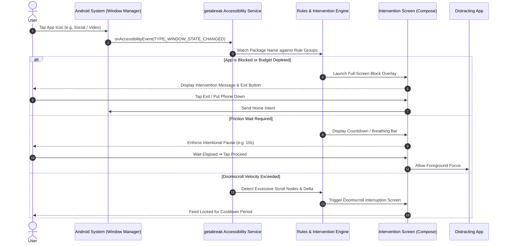
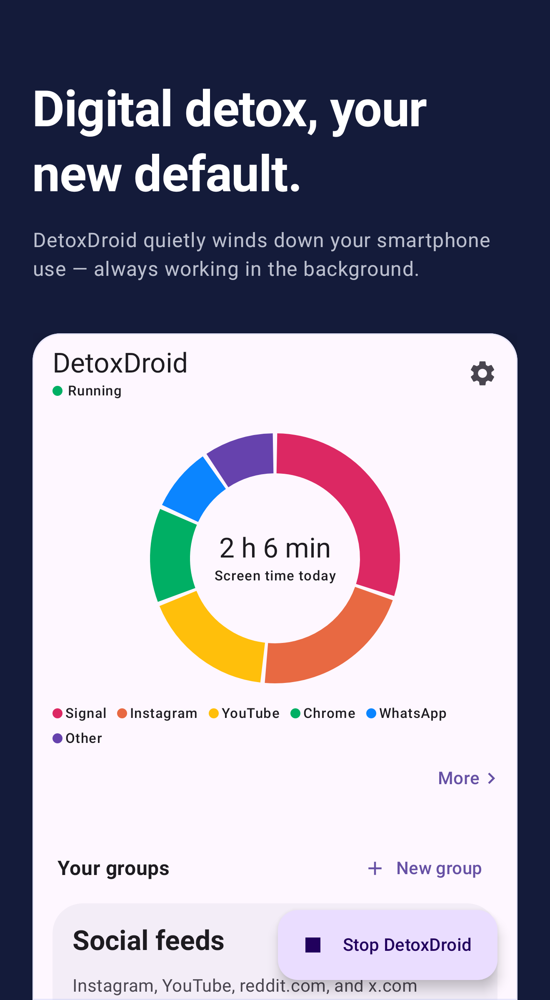
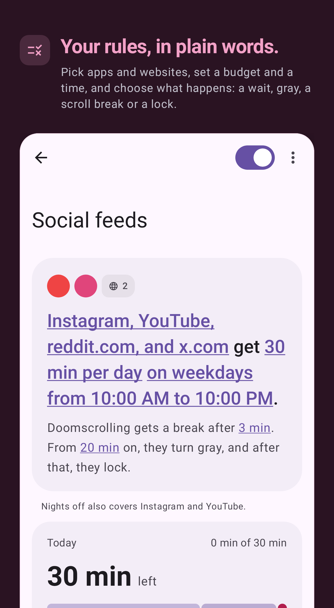
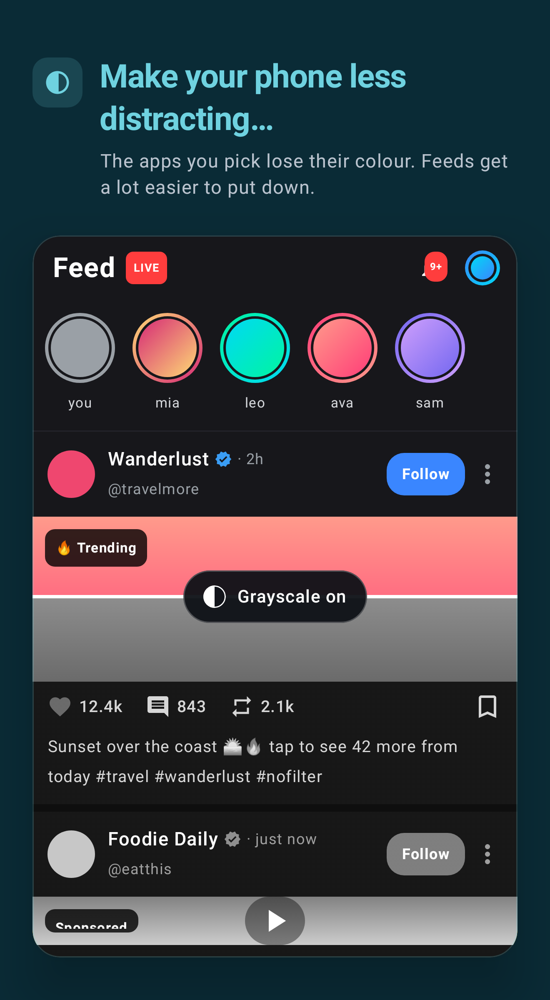
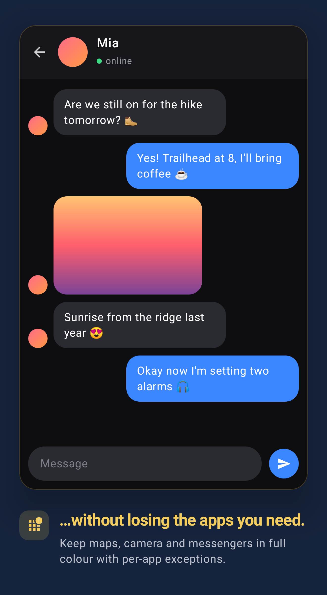
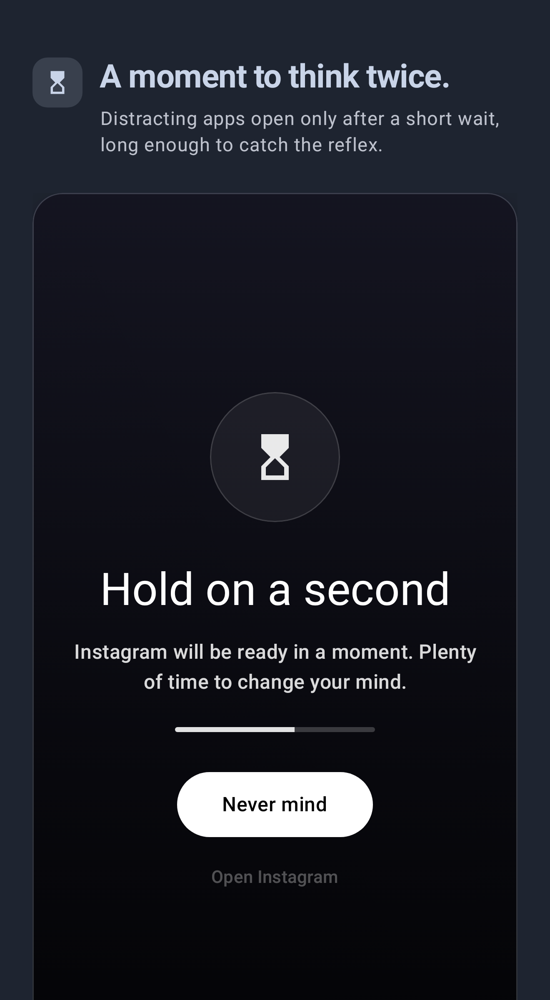
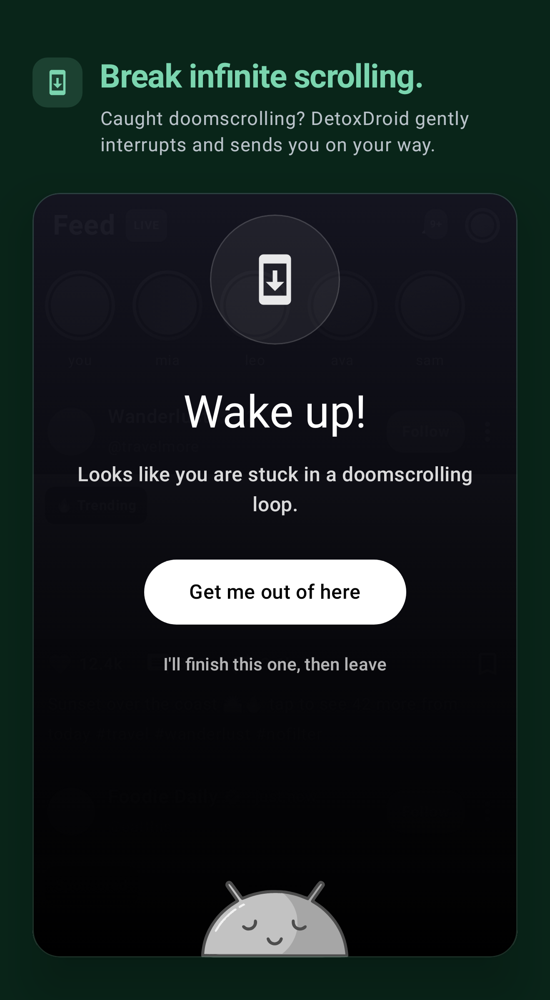

<p align="center">
  <a href="https://github.com/mizan989/getabreak-focus_app">
    
  </a>
</p>

<div align="center">

# getabreak

### Minimal, distraction-free digital wellbeing & focus utility for Android. Interruption science, doomscroll disruption, intelligent friction delays, real-time screen filters, and emergency focus lockdown — built natively with Kotlin & Jetpack Compose.

<br/>

<a href="#-quick-start"></a>
<a href="https://github.com/mizan989/getabreak-focus_app"></a>
<a href="https://github.com/mizan989/getabreak-focus_app/issues"></a>

<a href="#-core-architecture"></a>
<a href="#-building-from-source"></a>

<a href="https://github.com/mizan989/getabreak-focus_app/stargazers"></a>
<a href="LICENSE"></a>
<a href="https://kotlinlang.org"></a>
<a href="https://developer.android.com/jetpack/compose"></a>
<a href="https://developer.android.com/training/data-storage/room"></a>
<a href="https://developer.android.com/guide/topics/text/accessibility-services"></a>

</div>

> [!TIP]
> **Distraction-Free Digital Wellbeing:** getabreak makes a calm phone your baseline state. Unlike typical timers that demand continuous willpower, getabreak operates at the Android OS layer—desaturating apps into grayscale, introducing intentional friction delays before opening addictive apps, breaking endless scroll feeds, and enforcing locked focus intervals. 100% on-device, zero telemetry, zero accounts, and zero paywalls.

---

## getabreak Overview

**getabreak** is an open-source, system-level digital wellbeing utility engineered for Android. While most focus apps are opt-in and passive—asking you to manually start a timer and hope your willpower holds—getabreak reverses the burden: **a calm, focused phone becomes your default baseline**.

Designed according to the philosophy **Classic. Minimal. Calm. Precise. Native.**, getabreak avoids flashy gamification, badges, trophies, artificial streaks, or loud gradients. Instead, it pairs cognitive behavioral friction with deep Android platform capabilities—utilizing Accessibility Services, System Overlays, and Secure Settings to systematically interrupt compulsive phone checking and doomscrolling.

### Key Capabilities

- **Friction Before Opening** — Injects intentional cognitive pauses (3s–60s) with soothing breath timers before distracting apps launch.
- **Doomscroll Detection & Cooldowns** — Tracks scroll distance and velocity within short-form video and social feeds (Instagram Reels, YouTube Shorts, TikTok, X, Reddit) and enforces hard cooldown lockouts.
- **Visual Attenuation (Make Apps Boring)** — Strips dopamine-inducing colors by applying system grayscale, display dimming, and blur filters directly over specified applications.
- **Emergency Brake** — A one-tap emergency focus mode that instantly enforces your strictest rules, locks settings, disables pauses, and cannot be dismissed without a deliberate 10-minute cooldown.
- **Commitment Password** — Secures rule changes and app uninstallation behind a long-form passphrase, preventing impulse overrides during moments of weakness.
- **Minimalist Monochromatic Architecture** — Native Jetpack Compose interface in pure black (`#000000`), subtle neutral grays, clean typography, thin dividers, and restrained corner radii.
- **100% On-Device Privacy** — All usage stats, rule evaluations, and app tracking are calculated locally in Room DB and DataStore. Zero network requests, zero telemetry, zero analytics.

<br>

<div align="center">
  <pre>
┌─────────────────────────────────────────────────────────────────────────────────┐
│                                   getabreak                                     │
│          Interrupt Compulsion ➔ Enforce Friction ➔ Regain Attention            │
├───────────────────────────────┬─────────────────────────────────────────────────┤
│  🧠 Interruption Engine       │  🛡️ System-Level Enforcement                    │
│   • Accessibility node tracker│    • Grayscale & Hardware Color Matrix          │
│   • Scroll velocity detector  │    • Standalone System Alert Overlay            │
│   • Time & budget counters    │    • Shizuku / Secure Settings Integration      │
├───────────────────────────────┼─────────────────────────────────────────────────┤
│  🔒 Tamper Resistance         │  📊 Privacy-First Wellbeing Analytics           │
│   • Commitment Password       │    • 100% local Room DB & DataStore             │
│   • Emergency Brake lockouts  │    • Zero network analytics or tracking         │
└───────────────────────────────┴─────────────────────────────────────────────────┘
  </pre>
</div>

---

## Intervention Sequence Flow



---

## Core Wellbeing Features

### 1. Make Apps Boring
- **Grayscale Filter:** Disables color saturation so feeds lose their dopamine appeal.
- **Display Dimming:** Automatically dims the screen below system minimums when browsing addictive apps.
- **Blur Effects:** Blurs high-stimulation media on Android 12+.
- **Hardware Integration:** Supports real system grayscale via `WRITE_SECURE_SETTINGS` (using Shizuku, root, or ADB).

### 2. Break Doom Scrolling
- Monitors continuous vertical swipe distance and velocity inside social feeds.
- Interrupts endless consumption sessions with a breathing prompt.
- Enforces an escalating cooldown period to prevent immediately reopening the same feed.

### 3. Disable Apps & Daily Budgets
- Set individual or group time budgets per day.
- Every app launch costs an intentional friction wait until the budget is depleted, after which the application is firmly blocked.
- Supports complete deactivation, including notification suppression and launcher hiding where supported.

### 4. Emergency Brake
- For moments when focus slips: one tap activates your strictest restrictions.
- Locks settings, blocks all selected applications, and disables pauses.
- Ending early requires an intentional 10-minute wait—preventing impulsive cancels.

### 5. Commitment Password
- Protects settings, app exceptions, and uninstallation behind a custom passphrase.
- Requires typing out your passphrase character-by-character to modify rules.

### 6. Minimal Launcher & Screen Time Widgets
- **Minimal Launcher Widget:** Clean, text-only launcher on your home screen displaying only intentional apps.
- **Screen Time Donut:** Clean monochromatic overview of today's screen time, total unlock count, and most-used applications.

---

## UI Showcase

<p align="center">
  
  
  
  
  
  
</p>

---

## 🚀 Quick Start

### Prerequisites

- **Android Device / Emulator:** Android 8.0+ (API Level 26 or higher)
- **Development Environment:**
  - JDK 17 or JDK 21+
  - Android SDK (Build Tools 34.0.0+)
  - Gradle 8.5+

### Building from Source

```bash
# 1. Clone the repository
git clone https://github.com/mizan989/getabreak-focus_app.git
cd getabreak-focus_app

# 2. Build the debug APK
./gradlew assembleFossDebug

# 3. Install on connected device via ADB
adb install app/build/outputs/apk/foss/debug/app-foss-debug.apk
```

### Running Unit Tests

```bash
# Execute local unit tests
./gradlew testFossDebugUnitTest
```

---

## System Integration & Permissions

getabreak requires key Android permissions to enforce digital wellbeing at the OS layer:

| Permission | Purpose |
| :--- | :--- |
| **Accessibility Service** | Monitors foreground window changes, detects app launches, and tracks scroll depth to interrupt doomscrolling. |
| **Usage Stats (`PACKAGE_USAGE_STATS`)** | Reads on-device daily screen time and application launch counts for the dashboard and widgets. |
| **System Alert Window (`SYSTEM_ALERT_WINDOW`)** | Renders non-intrusive friction countdowns and intervention blocking screens over target apps. |
| **Notification Listener** | Mutes distracting notification badges and alerts while focus sessions or Do Not Disturb are active. |
| **Device Admin (Optional)** | Prevents impulsive uninstallation during active focus sessions when Commitment Password is enabled. |
| **Write Secure Settings (Optional)** | Enables native hardware grayscale and Extra Dim via Shizuku, root, or a one-time ADB command. |

### Optional: Enabling Native Grayscale via ADB

To grant getabreak access to the system hardware color matrix without root or Shizuku:

```bash
adb shell pm grant com.getabreak.app android.permission.WRITE_SECURE_SETTINGS
```

---

## Technical Architecture

```
app/src/main/java/com/getabreak/app/
├── data/                    # Room Database, DAOs, and DataStore delegates
├── features/                # Core feature modules (Brake, Doomscroll, CommitmentPassword, etc.)
├── rules/                   # Rule groups, thresholds, steps, and scheduling logic
├── system_integration/      # AccessibilityService, DeviceAdmin, OverlayService, and Watchdogs
├── ui/
│   ├── screens/             # Jetpack Compose screens (Home, About, UsageStats, RuleGroups, etc.)
│   ├── theme/               # Monochromatic theme, Color tokens, Typography, SubtleGlass modifier
│   └── widgets/             # Reusable UI components (SettingsGroups, OptionCards, AppSelection)
└── util/                    # Usage access helpers, navigation, and time formatters
```

- **Language:** Kotlin 1.9
- **UI Framework:** Jetpack Compose + Material 3
- **Dependency Injection:** Dagger Hilt
- **Local Persistence:** Room (SQLite) + Jetpack DataStore Preferences
- **Asynchronous Execution:** Kotlin Coroutines & Reactive StateFlow
- **Background Execution:** Android WorkManager + Foreground Service

---

## Open Source & Licence

getabreak is free and open-source software licensed under the **GNU General Public License v3.0** ([GPL-3.0](LICENSE)).

Based on the original DetoxDroid project by Felix Schulze, completely redesigned and rebranded as **getabreak** with a monochromatic native interface, zero donation/tip-jar requests, and ungated digital wellbeing capabilities.
